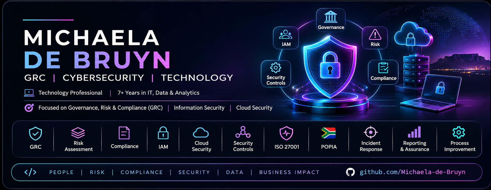

# 👋 Hi, I'm Michaela de Bruyn

### 🔐 GRC & Cybersecurity • Data Engineering • Technology & Process Improvement

📍 Cape Town, South Africa 🇿🇦

| | |
|:--|:--|
| **💼 Current Role** | Data Engineer at Lesaka |
| **📊 Experience** | 7+ years across technology, data & operations |
| **🔐 Cybersecurity Direction** | Governance, Risk & Compliance (GRC) |
| **☁️ Current Technical Focus** | SQL Server, GCP, data integration & migration |
| **📍 Location** | Cape Town, South Africa |

---

## 👩‍💻 A little about me

I'm a technology professional with 7+ years of experience across data engineering, analytics, IT support, business analysis and process improvement.

I currently work in **Data Engineering at Lesaka**, supporting data integration and migration from SQL Server into Google Cloud Platform (GCP). My work involves understanding existing data structures, mapping source tables and helping move data towards cloud-based solutions.

I'm also building practical cybersecurity capability, with a particular interest in **Governance, Risk and Compliance (GRC)**. I want to understand how organisations identify and manage risk, establish effective controls, protect information and turn security requirements into everyday business practices.

The common thread across my experience is investigation and improvement: understanding how something works, finding the gaps and helping make it better.

## 🎯 What I'm focused on

### 🔐 GRC & Cybersecurity

- Governance, Risk & Compliance fundamentals
- Information security governance and policies
- Risk identification, assessment and treatment
- Security controls and control gap assessments
- ISO/IEC 27001 fundamentals
- POPIA and information protection
- Identity and Access Management (IAM)
- Cloud security fundamentals
- Incident management and lessons learned
- Third-party and vendor risk

### ☁️ Data Engineering & Technology

- SQL Server to Google Cloud Platform (GCP) data migration
- SQL, Python and data transformation
- Data integration, mapping and validation
- BigQuery, Databricks and Azure
- Power BI, DAX and reporting
- Process analysis, documentation and workflow improvement

## 🧪 Building practical GRC experience

I'm developing a simulated company environment as a hands-on GRC portfolio project. The goal is to work through the GRC lifecycle and create realistic, structured evidence of my learning.

| Workstream | Practical deliverables |
|:--|:--|
| Company context | Business profile, services, assets and scope |
| Risk management | Risk register, scoring and treatment plans |
| Governance | Information security policies and procedures |
| Controls | Control mapping, evidence requirements and gap assessments |
| Compliance | Framework research and compliance mapping |
| Remediation | Findings, action owners and tracking |

*These are practical learning projects using a simulated organisation. I'll clearly distinguish simulated work from professional implementation experience.*

## 🏆 Featured Project

### 🤖 CapeConnect | AI Chatbot Governance, Risk & Security Assessment

**GRC Portfolio Project · Project Initiation**

I'm developing a practical GRC assessment for **CapeConnect**, a fictional South African technology-enabled customer service company planning to introduce an AI-powered customer support chatbot.

The project explores the information security, privacy, operational and third-party risks that can arise when an AI chatbot collects customer information, processes support conversations and relies on an external AI provider.

Rather than treating cybersecurity as only a technical exercise, this project looks at how a GRC analyst can understand the business, identify risks, evaluate safeguards, review evidence and communicate actionable recommendations to management.

**Assessment focus**
- Customer personal information and POPIA considerations
- Chatbot data collection, processing, storage and retention
- User access, permissions and information security controls
- Third-party AI provider risk and responsibilities
- Employee awareness, incident reporting and response
- Security policies, procedures and control gaps

**Frameworks & references**

\`POPIA\` · \`ISO/IEC 27001:2022\` · \`NIST Cybersecurity Framework 2.0\`

**Planned deliverables**

| Deliverable | Purpose |
|:--|:--|
| Risk assessment & risk register | Identify, evaluate and prioritise chatbot-related risks |
| Control assessment | Review the design of relevant security safeguards |
| Evidence register | Track evidence requested, received and reviewed |
| Compliance gap assessment | Identify potential gaps against selected requirements |
| Findings report | Document control weaknesses and recommendations |
| Remediation tracker | Monitor corrective actions |
| Executive summary | Communicate key risks and priorities to management |
| AI automation prototype | Explore AI-assisted document review, evidence classification and reporting |

*Fictional training and portfolio project. All company details, scenarios and evidence are simulated.*

## 🧰 Tools & Technologies

**Data, Development & Cloud**

**Platforms & Practices**

## 📌 Portfolio roadmap

- [ ] GRC practical lab: simulated company and security programme
- [ ] Risk assessment: risk register and treatment plan
- [ ] ISO 27001: control mapping and gap assessment
- [ ] IAM: access review and least-privilege exercises
- [ ] Cloud security: foundational security configuration and review

## 🐍 Contribution Snake

<picture>
  <source
    media="(prefers-color-scheme: dark)"
    srcset="https://raw.githubusercontent.com/Michaela-de-Bruyn/Michaela-de-Bruyn/output/github-contribution-grid-snake-dark.svg"
  />
  <source
    media="(prefers-color-scheme: light)"
    srcset="https://raw.githubusercontent.com/Michaela-de-Bruyn/Michaela-de-Bruyn/output/github-contribution-grid-snake.svg"
  />
  
</picture>

---

### 🤝 Let's connect

Interested in GRC, cybersecurity, IAM, cloud security, data engineering and technology operations? I'd love to connect.

**Always learning. Always investigating. Always improving.**

Designed & Built by **Michaela de Bruyn** 🇿🇦

